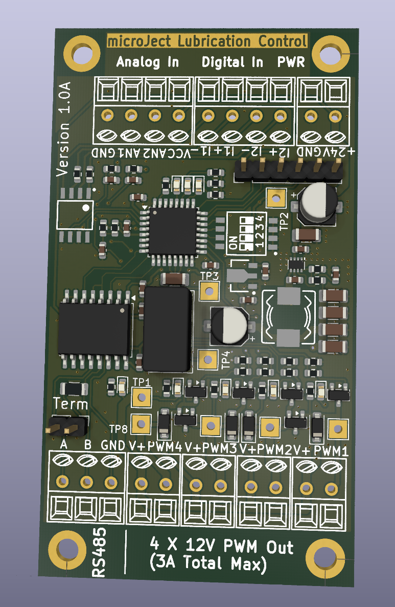

# microJect
MQL lubrication system using automotive injectors to lubricate cutting tools.

Control is via modbus RTU on RS485 or via switches and pots (Two channels only in that mode). 
Power input is 24V and power delivered to the injector heads is 12V at up to about 3A total from an on board power converter. 

Firmware is written in Rust with Embassy as the framework and the processor on the board is an STM32F030k6. 

#Electrical Interface 
|           |         |
|----------|----------|
| Power supply | 24V @ 1.5A but usually much less.|
| Injector outputs | 12V @1A, 3A total max | 
| Digital inputs | 2 Opto isolated, 24V max |
| Analogue inputs | 2, 3.3V max, intended for potentiometers|
| Serial interface | Isolated RS485 |

# Operating modes
There is a 4 way dip switch on the board which configure the operating modes
| Switch | Function |
|--------|----------|
| 1 | Enables local control mode, the opto inputs and analog control the first two channels|
| 2| Modbus alternate address, sets the modbus address to be 9 instead of 8 |
| 3, 4| Modbus baud rate| 

Baud rates
| SW 3 | SW 4| Baud Rate |
|------|-----|-----------|
| Off | Off | 4800 |
| Off | On | 9600 |
| On | Off | 19200 |
| On | On | 115200 |

# Modbus support

Modbus interface is RTU over RS485 half duplex, formatted as 8-E-1.

Coils
| Coil | Description | 
|------|-------------|
| 1 | Pulse enable for channel 1|
| 2 | Pulse enable for channel 2|
| 3 | Pulse enable for channel 3|
| 4 | Pulse enable for channel 4|

Note in modbus mode the coils will switch off 5 seconds after the last communication is received to avoid spilling coolant everywhere. 

Holding Registers
| Register | Description |
|----------|-------------|
| 1 | Channel 1 pulse length |
| 2 | Channel 1 period |
| 3 | Channel 2 pulse length |
| 4 | Channel 2 period |
| 5 | Channel 3 pulse length |
| 6 | Channel 3 period |
| 7 | Channel 4 pulse length |
| 8 | Channel 4 period |

Discrete inputs
| Input | Description |
|-------|-------------|
| 1 | Enable input for ch1 when in local control mode|
| 2 | Enable input for ch2 when in local control mode|

Analogue inputs 
| Input | Description |
|-------|-------------|
| 1 | 0-3.3V period control input for channel 1 when in local control mode|
| 2 | 0-3.3V period control input for channel 2 when in local control mode|

Both the discrete inputs and the analogue channels can be read over modbus when not using local mode so you can readily use them for other things when using modbus for control. 

